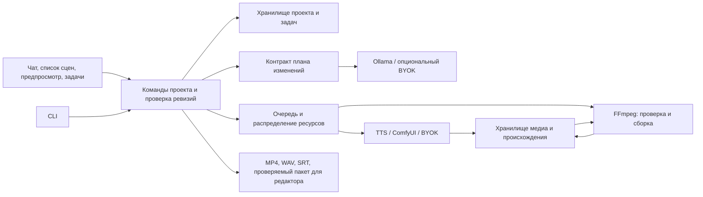

# Целевая архитектура

## Границы



- **Интерфейс** показывает диалог, сцены, превью и состояния задач. CLI использует тот же прикладной слой. Окно v0.2 можно развивать на Tk до измерения UX и поставки Windows.
- **Прикладной слой** проверяет схемы, версии и права действий. Ассистент получает ограниченный контекст проекта и формирует типизированный план. Только прикладной слой применяет изменения и создаёт задачи. Ответ модели хранится как данные.
- **Движки** получают конкретные входы и возвращают артефакты. Один адаптер для одного протокола/провайдера. Версии движка, моделей и профиля фиксируются рядом с результатом. Для ComfyUI сохраняется API workflow, для речи — голос, язык, настройки пауз и нормализации.
- **Монтажное ядро** принимает снимок сцен и звука. FFmpeg делает нормализацию, черновой склейку, микс, MP4 и SRT. Передача в Kdenlive сначала через пакет файлов с точными длительностями. OTIO проходит отдельный тест таймлайна, клипов, звука и субтитров в указанной версии редактора.
- **Регистрация ресурсов** обнаруживает доступные бинарники, доступную память, диск и возможности адаптеров. Она планирует работу независимо от UI.

## Хранилище и перенос

Одна SQLite БД `project.sqlite` на проект со схемой и миграциями. Записи проекта, ревизии и очередь согласуются одной транзакцией. Исходники и результаты лежат в `assets/<sha256>.<ext>`. `.cache/` можно пересобрать. Помощник экспорта проекта использует SQLite backup API и копирует только необходимые артефакты по хешам. При открытии копии сверяются ссылки, схема и целостность. JSON v1 импортируется в новый каталог транзакционно, со стабильными идентификаторами сцен, полями старой версии и проверкой файлов до публикации. Тест миграции сравнивает порядок, профиль, субтитры и медиассылки до и после.

| Сущность | Поля и инварианты |
|---|---|
| `project`, `episode` | UUID, версия схемы, ревизия, название, профиль fps/формата, FK проекта |
| `scene`, `scene_revision` | UUID сцены и эпизода, порядок, trim/duration в кадрах, входы visual/voice, реплики и субтитры с диапазонами кадров, выбранная версия результата. Правка создаёт новую ревизию |
| `asset` | SHA-256, тип, размер, длительность и профиль потока, источник, права, идентификатор задачи. Имена и пути внешних файлов хранятся только как справочные данные |
| `character_revision`, `scene_reference` | ID и версия персонажа, хеши референсов, описание и ограничения. Связь сцены с конкретными версиями. Единый референс задаёт вход, а согласованность внешности оценивается на серии кадров |
| `recipe`, `artifact_link` | Вид задачи, зафиксированный движок/модель/голос, хеш workflow, промпт, отрицательный промпт, seed, параметры и входные хеши. Артефакт связан с рецептом и исходной ревизией |
| `job`, `job_event` | ID, вид, снимок входов, ключ идемпотентности, состояние, номер попытки, lease, код ошибки, внешний ID, отметки времени, хеши результатов. Секреты представлены идентификатором профиля ОС |

## Контракты

Локальные структуры прикладного слоя вызываются из Python и CLI. Сетевой сервер не нужен для v0.2.

```text
PlanRequest {projectId, episodeId, baseRevision, text, contextRefs}
PlanResult {baseRevision, operations[], derivedJobs[], warnings[]}
Operation = AddScene | UpdateScene | MoveScene | SelectArtifact | AttachReference
ApplyPlan {planId, expectedRevision, commandId} -> {revision, jobIds} | Conflict
JobSpec {kind, recipeVersion, inputHashes[], resourceProfile, attemptPolicy}
Adapter.capabilities() -> {kinds[], version, cancelMode, resourceProfiles[]}
Adapter.submit(spec, idempotencyKey) -> {runId}
Adapter.status(runId) -> {state, progress, code}
Adapter.cancel(runId) -> {accepted}
Adapter.collect(runId) -> {files[], provenance}
RenderEpisode {snapshotId, profile, outputPath, overwrite} -> {artifactHash, sceneHits}
```

Ошибки имеют стабильные коды `invalid-input`, `revision-conflict`, `engine-unavailable`, `out-of-memory`, `disk-full`, `cancelled`, `timeout`, `unsupported-media`. Логи ограничены по размеру. Абсолютные пути, текст реплик и секреты исключаются из диагностических пакетов по умолчанию. BYOK выключен до настройки, ключ через хранилище ОС, отдельное разрешение на отправку выбранных медиа и расход средств. Никакого автоматического перехода с локального движка в облако.

## Выполнение, кэш и ресурсы

- Задачи переходят из `queued` в `running`, затем в `succeeded`, `failed` или `cancelled`. Отмена во время работы проходит через `cancel-requested`. Снимок входов неизменяем. Worker обновляет lease. После аварии локальная задача повторяется при истёкшем lease, если запись результата отсутствует. Для внешней сначала запрашивается состояние сохранённого `runId`. При неизвестном состоянии требуется явное решение перед повтором потенциально платной отправки.
- Результат записывается во временный файл, проверяется и публикуется атомарно. Транзакция связывает результат с исходной версией сцены. Если сцену уже изменили, артефакт остаётся вариантом и не подменяет текущий выбор. Один активный коммит для одного назначения в очереди. При отмене до начала публикации прежний MP4 остаётся доступен.
- Ключ генерации хеширует канонический рецепт, входные хеши, seed, профиль и фактическую версию моделей/узлов. Явная новая генерация получает новый seed или nonce. Ключ рендера сцены использует хеши визуала/голоса, тайминг, кадрирование и профиль/версию FFmpeg. Правка текста субтитра меняет дорожку и финальную сборку. Правка голоса меняет аудио и ключ соответствующей сцены. Фоновый микс и финальная упаковка отделяются от визуального кэша по мере появления дорожек.
- Профиль ноутбука начинает с одного GPU-задания или CPU-экспорта в фоне. Русский голос предпочтительно на CPU. LLM на CPU или отдельным этапом, если GPU нужен графу. Ориентиры допуска для первого рецепта — пиковая общая VRAM до 5,5 GiB, рабочая RAM процессов EFIR и движков до 10 GiB, минимум 2 GiB свободной системной RAM и запас диска по размеру staging. Проверить на практике по каждому графу. Варианты при OOM выбираются явно и записываются как новый рецепт. Импорт медиа остаётся доступным даже при отказе генерации.
- ComfyUI подключается к выбранной локальной установке через очередь `/prompt`, прогресс `/ws`, результаты `/history/{prompt_id}` и `/view`. Прерывание общего исполнителя не отправляется без подтверждения принадлежности текущей работы EFIR. Пользовательские узлы и модели устанавливаются отдельно. У Ollama — локальный `/api/chat` с JSON Schema и повторная валидация результата в EFIR. [Маршруты ComfyUI](https://docs.comfy.org/development/comfyui-server/comms_routes), [структурированные ответы Ollama](https://docs.ollama.com/capabilities/structured-outputs).
